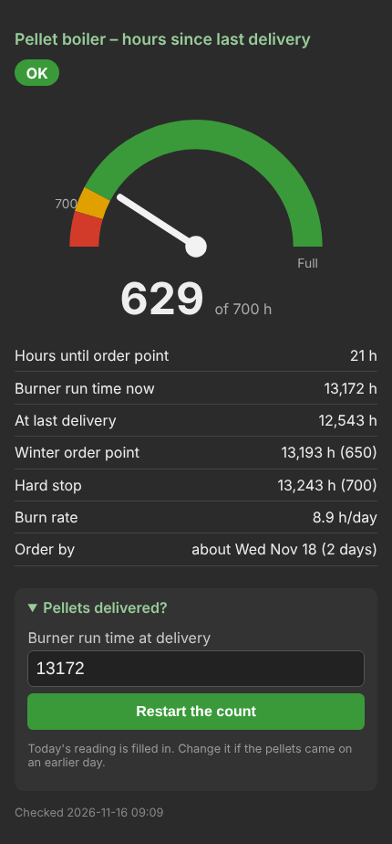

# Ökofen Pellet Boiler – pellet reorder reminder

Know when to order pellets for an **ÖkoFEN Pellematic** boiler, without extra hardware.

`pellet_watch.py` reads the boiler's **burner run time** over its local JSON interface, counts the hours since your last pellet delivery, and:

- shows a fuel-gauge status page you can add to your phone's home screen
- alerts you (email or phone push) when it's time to order, with an earlier order point in winter
- has a **"Pellets delivered?"** button on the page to restart the count after a refill



## Why burner hours?

Pellet use tracks burner run time closely. For a hopper that's refilled when nearly empty, the hours between deliveries are a reliable "fuel gauge". Ökofen sells weighing cells for the storage tank that do this properly. This project is the free, software-only version for everyone else.

## What you need

- An ÖkoFEN boiler with a **Pelletronic Touch** controller on your home network
- An always-on machine on the same network with **Python 3** (no extra packages):
  a **Synology NAS**, a **Raspberry Pi** or other Linux box, or a Windows/Mac computer that doesn't sleep

The boiler's JSON interface only answers on your home network, so the script has to run there. It does **not** use your my.oekofen.info login.

## 1. Turn on the boiler's JSON interface

On the Pelletronic Touch screen, unlock the advanced mode (lock icon), then go to **General → IP Config** (network settings) and scroll to the bottom:

- **JSON mode / JSON interface:** On (leave compatibility mode off)
- Note the **JSON port** (usually `4321`) and the **JSON password**
- Note the boiler's **IP address**. Giving it a fixed address (a DHCP reservation in your router) saves trouble later.

Test it from any browser on your network (fill in your values):

```
http://BOILER_IP:4321/JSON_PASSWORD/all
```

You should see a page of JSON. Look for `pe1` → `L_runtime`: that's the burner run time in hours, the same number the touchscreen and app show as *PE1 Burner Run Time*.

## 2. Install and configure

Put these files in one folder on the always-on machine:

- `pellet_watch.py`
- `pellets-icon.png`
- `pellet_watch_config.json`: a copy of `pellet_watch_config.example.json`, renamed and edited

Minimum config:

```json
{
  "BOILER_IP": "192.168.1.50",
  "JSON_PORT": 4321,
  "JSON_PASSWORD": "your-json-password"
}
```

Optional keys (defaults in brackets):

| Key | Meaning |
|---|---|
| `FIRST_BASELINE` | Burner hours at your last delivery, used on the first run only [count from now] |
| `WINTER_MONTHS` | Months that use the winter thresholds [`[10,11,12,1,2,3,4]`] |
| `WINTER_ORDER` / `WINTER_STOP` | Winter order point / hard stop, in hours since delivery [650 / 700] |
| `SUMMER_ORDER` / `SUMMER_STOP` | Summer order point / hard stop [675 / 700] |
| `HTML_PATH` | Where to write the status page [`pellets.html` next to the script; `""` = none] |
| `SERVE_PORT` | Port for the page's reset button and built-in web server [8765] |
| `NTFY_TOPIC` | Optional phone push via [ntfy.sh](https://ntfy.sh): a hard-to-guess topic name [off] |

Your settings live in the config file, so you can drop in a newer `pellet_watch.py` without re-entering anything.

Run it once by hand:

```bash
python3 pellet_watch.py
```

It prints something like `629 burner hours used since the last delivery; winter order point is 650 h, hard stop 700 h.`

If your last delivery was earlier, tell it the reading from that day:

```bash
python3 pellet_watch.py --delivered 12543
```

## 3a. Synology NAS

Put the files in the `web` shared folder (Web Station serves it as `http://YOUR-NAS/`). SSH in and test with `python3 /volume1/web/pellet_watch.py`.

In **Control Panel → Task Scheduler** create two tasks:

1. **Scheduled Task → User-defined script**: daily or every few hours.
   - Run command: `python3 /volume1/web/pellet_watch.py`
   - Task Settings: tick **Send run details by email** and **only when the script terminates abnormally**. The script exits with an error code at the order point and the hard stop, so DSM emails you. (Control Panel → Notification → Email must be set up.)
2. **Triggered Task → User-defined script**, Event **Boot-up**, user `root`.
   - Run command: `python3 /volume1/web/pellet_watch.py --serve`
   - Select it and click **Run** once to start it now. This powers the "Pellets delivered?" button.

Page: `http://YOUR-NAS/pellets.html`. If the DSM firewall is on, allow port 8765 from your LAN.

> Anything in `web` can be fetched by a browser. If your NAS web server is reachable from the internet, keep the script and config in another shared folder and point `HTML_PATH` at the `web` folder.

## 3b. Raspberry Pi / Linux

The `--serve` mode also serves the page, so no web server is needed. The page is at `http://PI-ADDRESS:8765/`.

Hourly check with cron (`crontab -e`), adjusting the path:

```
0 * * * * /usr/bin/python3 /home/pi/pellets/pellet_watch.py
```

Keep `--serve` running with systemd. Create `/etc/systemd/system/pellet-watch.service`:

```ini
[Unit]
Description=Pellet watch page and reset button
After=network-online.target

[Service]
ExecStart=/usr/bin/python3 /home/pi/pellets/pellet_watch.py --serve
Restart=always
User=pi

[Install]
WantedBy=multi-user.target
```

```bash
sudo systemctl enable --now pellet-watch
```

For alerts, the easiest option on a Pi is phone push: set `NTFY_TOPIC` and subscribe to that topic in the ntfy app.

## 3c. Windows

Install Python from python.org, then in **Task Scheduler**:

- A task that runs `python C:\pellets\pellet_watch.py` every hour
- A task **At startup** that runs `python C:\pellets\pellet_watch.py --serve`

Page: `http://THIS-PC:8765/`. Allow Python through Windows Firewall when asked. Use `NTFY_TOPIC` for alerts.

## After a pellet delivery

Open the page, tap **Pellets delivered?**, check the reading (it's pre-filled with today's), and tap **Restart the count**.

Or from a terminal:

```bash
python3 pellet_watch.py --delivered            # use the boiler's current reading
python3 pellet_watch.py --delivered 13250      # or the reading on delivery day
```

## Choosing your thresholds

You want the pellets to arrive before the hopper runs dry. Three numbers decide it:

1. **Hopper capacity** in lbs or kg
2. **Pellets burned per burner hour**: pounds delivered ÷ burner hours since the previous delivery. Log this at each delivery; it varies a lot (7.5–9.5 lbs/h on the boiler this was built for).
3. **Delivery lead time** × **burner hours per day**: 7–10 days at 8–10 h/day in winter is ~100 h; summer is often only 3–4 h/day.

**Hours to empty** ≈ capacity ÷ lbs per hour. **Order point** ≈ hours to empty − lead-time hours. Example: a 6,600 lb hopper at 8.5 lbs/h runs dry around 775 h, so with ~100 h of winter lead time, order by ~675 h. At 9.5 lbs/h it runs dry around 695 h, so order by ~600 h.

Also check your supplier's minimum delivery: ordering too early may mean a small-delivery fee.

The page shows your measured burn rate (h/day) and an estimated "Order by" date once it has a few days of readings.

## Exit codes

| Code | Meaning |
|---|---|
| 0 | Fine |
| 1 | Order point or hard stop reached |
| 2 | Couldn't read the boiler |

## Security notes

- The reset button has no password: anyone on your home network who opens the page can press it. Don't forward its port to the internet.
- The JSON password is in `pellet_watch_config.json`. Keep that file out of public web folders where possible.

## Credits

- Field names from the community [Ökofen JSON documentation](https://github.com/thannaske/oekofen-json-documentation)
- Not affiliated with or endorsed by ÖkoFEN. "ÖkoFEN" and "Pellematic" are trademarks of their owner.

## License

MIT, see [LICENSE](LICENSE).
